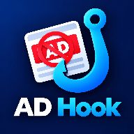
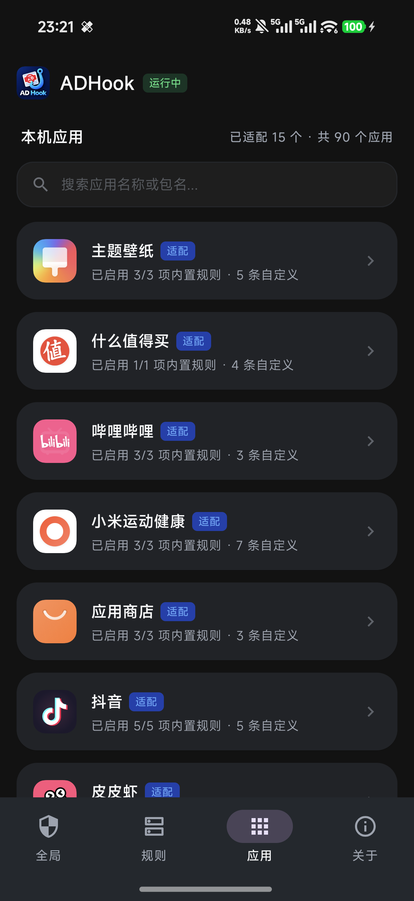
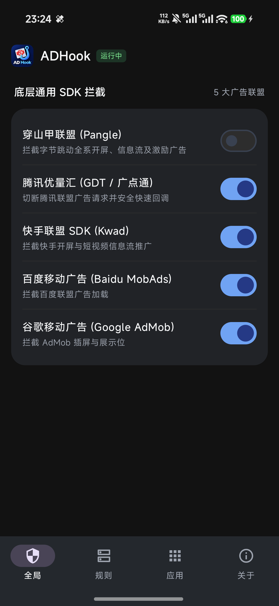
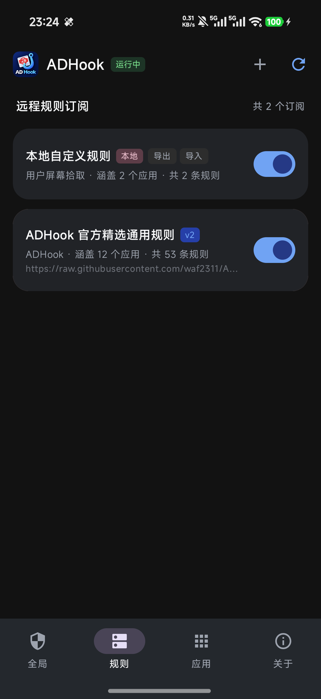
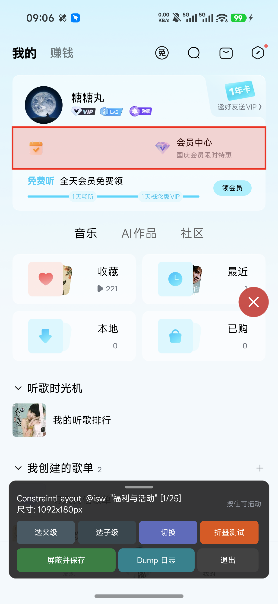

  

<h1 align="center">ADHook</h1>

  <b>基于 LSPosed / Xposed 框架的现代 Android 移动应用去广告与界面净化利器</b> 
  免权限所见即所得屏幕拾取器 · 5 大商业化广告联盟底层断源 · 深度原生无痕去广告

  
  
  
  

---

## 📸 界面预览

<table align="center">
  <tr>
    <td align="center" width="25%">
      <b>📱 应用管理与深度适配</b>  
      
    </td>
    <td align="center" width="25%">
      <b>🛡️ 全局广告联盟总控</b>  
      
    </td>
    <td align="center" width="25%">
      <b>📋 规则管理与统管中心</b>  
      
    </td>
    <td align="center" width="25%">
      <b>🔍 可视化元素拾取器</b>  
      
    </td>
  </tr>
</table>

---

## 📥 下载安装

请前往 [**Releases 发版页面**](https://github.com/a742870158/ADHook-Release/releases) 下载最新正式版 APK。

1. 在手机上安装支持的 **LSPosed 框架**（推荐 Magisk / KernelSU / APatch 下的 Zygisk 模式）；
2. 安装 **ADHook.apk**；
3. 打开 LSPosed 管理器，在「模块」中启用 **ADHook** 并勾选需要去广告的目标应用作用域；
4. 强退目标应用重新打开，即可享受纯净无广告体验。

> [!IMPORTANT]
> ### 📢 重要提示：关于作用域勾选与去广告范围
> - **深度定制 vs 通用托管**：下方列表中已声明包名的应用拥有专属的深度逆向与定制去广告实现（如冷热开屏秒开、底栏精简、特定信息流过滤、去水印等）；
> - **去广告不仅限于声明的应用**：ADHook 的去广告与界面净化能力**绝不仅限于**这几个预设应用！
> - **任意 App 自由去广告**：请在 **LSPosed 管理器的模块作用域中，勾选任意想要去除广告的应用**。被勾选的应用将自动激活底层通用广告联盟断源（穿山甲/优量汇/快手/AdMob等），并且可在应用内随心开启**原生可视化悬浮拾取器**，自由框选、测试并保存屏蔽规则，消除界面中的任意广告卡片与空白！

---

## 🚀 核心特性

### 1. 🎛️ ADHook 规则中心 (Jetpack Compose / Material 3 原生 UI)
- **全新原生声明式架构**：遵循 Material 3 设计规范，支持 Edge-to-Edge 全沉浸式状态栏与手势交互，深浅色模式自动适配。
- **四大核心控制体系**：
  - **全局**：一键总控穿山甲 (Pangle)、腾讯优量汇 (GDT)、快手 (Kwad)、百度移动广告、谷歌 AdMob 等 5 大广告联盟底层断源。
  - **规则**：管理自定义规则与订阅条目，支持一键导出、导入与滑动删除。
  - **应用**：全盘已安装应用极速搜索，深度定制适配方案优先置顶。
  - **关于**：框架运行状态、版本信息、官方 QQ 交流群与**一键检测 GitHub 最新 Release 版本更新（支持直接下载升级与进度展示）**。
- **通用应用零配置自动托管**：只要在 LSPosed 作用域中勾选任意第三方应用，无需硬编码预置，自动挂载底层广告联盟断源与悬浮窗拾取器。

### 2. 🔍 原生视图可视化拾取器 (Visual Element Picker)
告别繁琐的“截图-描述-反编译猜类名-试错”，把去广告转变为**所见即所得的手机端操作**：
- **免系统悬浮窗权限**：基于 Activity 顶层子窗口运行，不占用系统全局悬浮窗权限，零后台保活开销；
- **高科技准星悬浮球**：微透深空灰黑质感底色与荧光青蓝瞄准十字准星，避开系统侧滑冲突区，上下自由拖拽吸附；
- **红框高亮与层级漫游**：触摸屏幕任意 View 自动高亮，支持 **`[ 选父级 ]`** 向上扩大选区、**`[ 选子级 ]`** 精确回退、**`[ 切换 ]`** 贯穿层级轮转；
- **In-View 纯内嵌模态弹窗**：点击 `[屏蔽并保存]` 展开暗黑科技风面板，杜绝系统 BadToken 异常与点击穿透；
- **智能特征提取与相对深度计算**：自动提取节点文案与控件 ID，选中父级卡片时自动计算相对层级深度，彻底消除整行卡片；
- **高危类名防误杀护栏**：智能阻断通用容器类名（如 `HyperCellLayout`、`FrameLayout` 等）的纯类名折叠，根绝同类条目全量消失隐患。

---

## 🎯 深度适配应用列表

| 应用名称 | 包名 | 核心适配特性 |
| :--- | :--- | :--- |
| **小红书** | `com.xingin.xhs` | 原图原视频无水印保存（支持保留作者贴纸）、解除作者禁止保存限制、信息流 2-pos 广告拦截、搜索赞助卡与直播带货卡过滤、分享链接追踪参数自动剥离 |
| **酷狗音乐概念版** | `com.kugou.android.lite` | 腾讯优量汇 GDT 深度空响应伪造（零流量零闪烁）、冷热开屏秒开、播放器悬浮推广与免流条折叠、每日自动静默领取 VIP |
| **网易云音乐** | `com.netease.cloudmusic` | 消除红屏等待延迟秒进首页、开屏秒开与摇一摇阻断、首页 Banner 与推荐流商业卡片抹除、黑胶播放页营销浮层治理、音频贴片广告跳过 |
| **高德地图** | `com.autonavi.minimap` | 业务启动决策阻断开屏、阿里妈妈商业广告通道掐断、搜索框热词轮播冻结、地图悬浮运营挂件全分辨率自适应消除、首页滑动边界锁定、打车与我的页面净化、底栏 4 Tab 精简 |
| **哔哩哔哩** | `tv.danmaku.bili` | 冷热开屏双重阻断、首页右上角游戏中心移除、底栏 3 栏均分布局（剔除会员购与发布加号）、个人中心大会员营销横幅与我的服务卡片精简 |
| **皮皮虾** | `com.sup.android.superb` | 冷热开屏断源、信息流广告与热搜营销词过滤、顶部分类仅保留「关注与推荐」、底栏极简 50%/50% 对称双栏、无水印视频原图下载 |
| **酷安** | `com.coolapk.market` | 穿透网易易盾加壳、开屏广告秒开、信息流自营赞助卡片零高度折叠、评论区商业广告卡片精准折叠 |
| **虎扑** | `com.hupu.games` | 冷热开屏 0 秒直入首页、商业化广告 SDK 初始化阻断、信息流双层无痕过滤、全场景广告与免广告特权弹窗拦截、底栏「专区/深聊」Tab 精简（保留首页/发布/我的） |
| **美团** | `com.sankuai.meituan` | 冷启动开屏秒开、热启动切前台闪屏阻断、系统通知反复开启诱导弹窗彻底消除 |
| **抖音** | `com.ss.android.ugc.aweme` | 广告 SDK 核心总开关全局禁用、主推荐流与可玩广告无痕折叠、激励视频秒过保留奖励、左上角悬浮活动红包挂件彻底消除 |
| **小米运动健康** | `com.mi.health` | 冷启动开屏与活动横幅切断、健康页运营横幅折叠、底栏彻底移除「运动」Tab（健康/设备/我的 3 等分对称排列）、设备页轮播横幅与橙色未读小红点消除、「我的」页面营销卡片全净化紧贴个人信息 |
| **小米主题壁纸** | `com.android.thememanager` | 底栏仅保留「分类」与「我的」（默认直达分类）、搜索引导页仅保留「搜索历史」、详情页广告卡片切断与广告容器折叠、消除新手打赏气泡 |
| **小米应用商店** | `com.xiaomi.market` | 开屏与全局弹窗切断、首页 Tab 隐藏顶部空白留白直接呈现「金米奖」、我的页面卡片重构撑满整行、解除跨签名覆盖安装与下载限制 |
| **领克** | `com.lynkco.customer` | 穿透几维安全加壳、隐藏底栏 Tab 容器撑满全屏、冷启动默认直达「爱车」页、爱车页官方二手车推广背景与商品推荐横幅全净化 |
| **什么值得买** | `com.smzdm.client.android` | 开屏物料磁盘缓存与网络拉取断流、毫秒级跳过 3 秒海报与滑动手势遮罩、切后台后台下载阻断 |

---

## ⚠️ 免责声明

1. 本项目仅供 Android 逆向工程、无障碍辅助交互与界面布局渲染优化的技术交流与学习研究使用；
2. 本项目所实现的功能均运行于用户本地设备运行时内存中，不修改、不反编译重打包任何第三方应用的原始安装包文件；
3. 请勿将本项目用于任何侵犯第三方软件开发者合法权益的商业营利行为。

---

## 💬 问题反馈与交流

- **官方 QQ 交流群**：`1132195799`（[👉 点击直达加入群聊【ADHook】](https://qun.qq.com/universal-share/share?ac=1&authKey=N2ORngE1ODWIODTIXCymZ9YQlcq66n67CmPnBQnj7zGjaboeLUjrB5gUOPTsAvtP&busi_data=eyJncm91cENvZGUiOiIxMTMyMTk1Nzk5IiwidG9rZW4iOiJOR3liT1JoL1owck4zK1pYQ29oNnJ5d2RlZUJxNmFKaXgyZ3h2dDF5ekgwdzFMeEJmSThzeU1TdVg5SHpMQVJSIiwidWluIjoiNzQyODcwMTU4In0%3D&data=EmqDA1owmF6yNkZ6PJdJKkpoLPZw7EKq90RUlaOQoDGQFvmm1Zq1Fp_QFoX4_GHMPJM1h0ea0c9gWLW_tpmB7Q&svctype=4&tempid=h5_group_info)）
- **GitHub Issues**：如果您在使用过程中遇到任何规则失效、界面误伤或希望适配新应用，欢迎随时提交 [**GitHub Issues**](https://github.com/a742870158/ADHook-Release/issues)！
