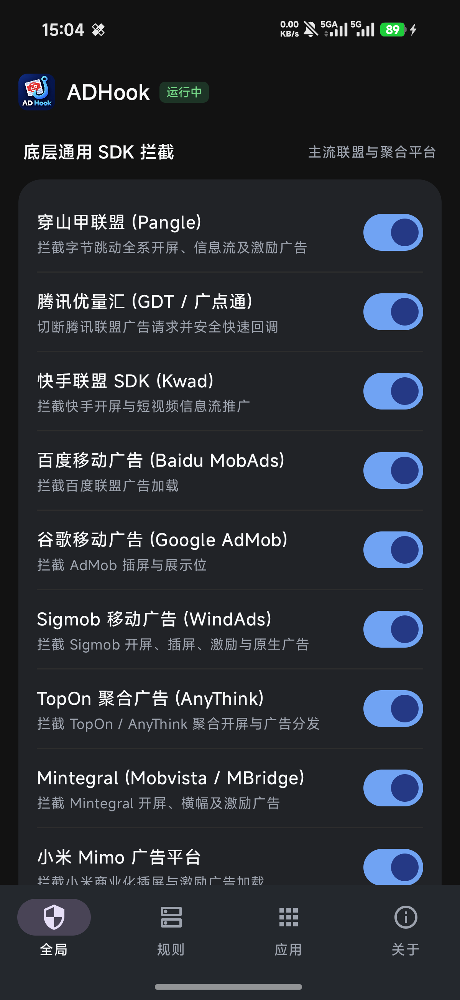
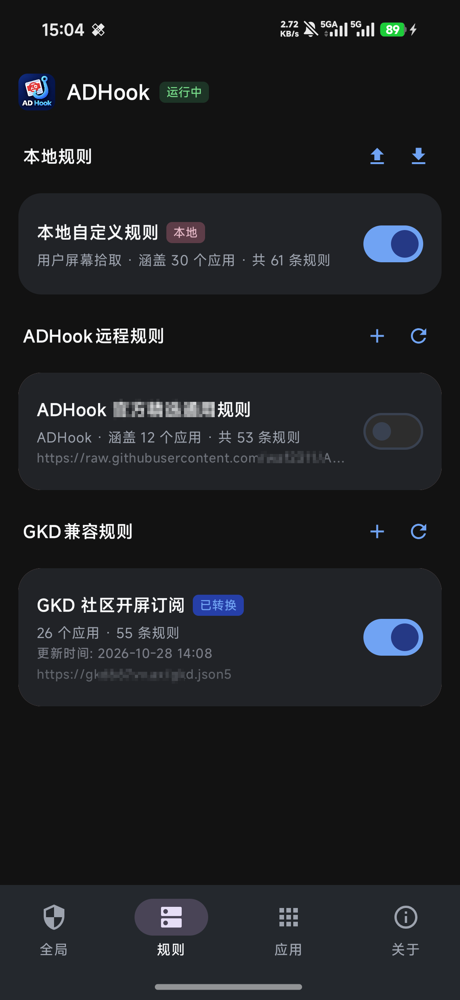
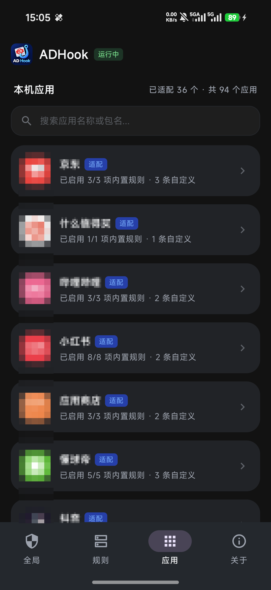
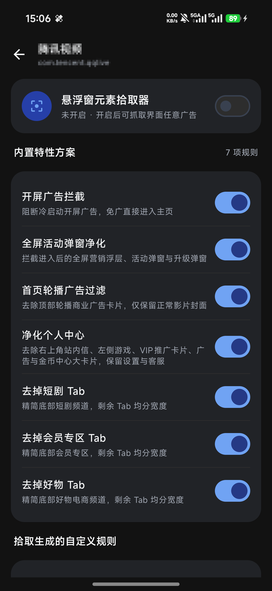

  

<h1 align="center">ADHook</h1>

  <b>基于 LSPosed / Xposed 框架的现代 Android 移动应用去广告与界面净化利器</b> 
  零无障碍权限更快更省电 · 免权限屏幕拾取器 · 9 大广告厂商底层断源 · GKD 规则订阅无缝兼容

  
  
  
  

---

## 📸 界面预览

<table align="center">
  <tr>
    <td align="center" width="25%">
      <b>🛡️ 全局广告联盟总控</b>  
      
    </td>
    <td align="center" width="25%">
      <b>📋 规则管理与统管中心</b>  
      
    </td>
    <td align="center" width="25%">
      <b>📱 应用管理与状态概览</b>  
      
    </td>
    <td align="center" width="25%">
      <b>⚙️ 单应用详情与特性方案</b>  
      
    </td>
  </tr>
</table>

---

## 📥 下载安装

请前往 [**Releases 发版页面**](https://github.com/a742870158/ADHook-Release/releases) 下载最新正式版 APK。

1. 在手机上安装支持的 **LSPosed 框架**（推荐 Magisk / KernelSU / APatch 下的 Zygisk 模式）；
2. 安装 **ADHook.apk**；
3. 打开 LSPosed 管理器，在「模块」中启用 **ADHook** 并勾选需要去广告的目标应用作用域；
4. 强退目标应用重新打开，即可享受纯净无广告体验。

> [!IMPORTANT]
> ### 📢 重要提示：关于作用域勾选与去广告范围
> - **深度定制 vs 通用托管**：针对多款主流应用拥有专属的深度逆向与定制去广告实现（如冷热开屏秒开、底栏精简、特定信息流过滤、去水印等）；
> - **去广告不仅限于声明的应用**：ADHook 的去广告与界面净化能力**绝不仅限于**预设应用！
> - **任意 App 自由去广告**：请在 **LSPosed 管理器的模块作用域中，勾选任意想要去除广告的应用**。被勾选的应用将自动激活底层通用广告联盟断源（穿山甲/优量汇/快手/AdMob/Sigmob等），并且可在应用内随心开启**原生可视化悬浮拾取器**，自由框选、测试并保存屏蔽规则，消除界面中的任意广告卡片与空白！

---

## 🚀 核心特性

### 1. 🎛️ ADHook 规则中心 (Jetpack Compose / Material 3 原生 UI)
- **全新原生声明式架构**：遵循 Material 3 设计规范，支持 Edge-to-Edge 全沉浸式状态栏与手势交互，深浅色模式自动适配。
- **四大核心控制体系**：
  - **全局**：一键总控穿山甲 (Pangle)、腾讯优量汇 (GDT)、快手 (Kwad)、百度移动广告 (Baidu MobAds)、谷歌移动广告 (Google AdMob)、Sigmob (WindAds)、TopOn (AnyThink)、Mintegral (Mobvista)、小米 Mimo 等 **9 大主流广告厂商与聚合平台** 底层断源。
  - **规则**：三层规则立体统管体系（**本地自定义规则** + **ADHook 远程规则** + **GKD 兼容规则**），支持一键导出、导入与滑动删除。
  - **应用**：全盘已安装应用极速搜索，深度定制适配方案优先置顶，支持按应用名称与包名实时模糊搜索。
  - **关于**：框架运行状态、版本信息、官方 TG 交流群与**一键检测 GitHub 最新 Release 版本更新（支持直接下载升级与进度展示）**。
- **通用应用零配置自动托管**：只要在 LSPosed 作用域中勾选任意第三方应用，无需硬编码预置，自动挂载底层广告联盟断源、自定义规则引擎与悬浮窗拾取器。

### 2. ⚡ GKD 规则订阅无缝兼容与智能转换
- **直接导入 GKD 规则订阅**：支持直接配置并一键同步 GKD 开源社区的 `.json5` / `.json` 订阅直链；
- **智能开屏规则提取**：全自动扫描并提取订阅中针对开屏广告跳过的节点规则（支持 Activity 匹配、资源 ID 匹配与文本特征匹配），智能转译为 ADHook 高性能原生自定义规则并安全持久化；
- **增量同步与差量预览**：拉取时提供精确的“匹配应用数 / 新增 / 更新 / 剔除规则数”差量预览，确认后平滑合并落盘，且自动继承用户原有的规则开关偏好；
- **宿主进程零额外开销**：支持全局一键启闭 GKD 兼容规则，单应用详情页中亦支持单独查看、切换及左滑移除每条 GKD 转换规则。

### 3. 🎯 多层递进式开屏广告消除与兜底体系
不同于依赖系统无障碍服务的传统跳过工具，ADHook **完全不使用系统无障碍（Accessibility）权限**，所有操作均直接在宿主应用进程内部原生执行，没有跨进程事件轮询与无障碍服务常驻后台的功耗负担，**理论跳过广告更快、响应更即时、更省电**。在此基础上构建了「专有秒开 -> 自动跳过 -> GKD 规则兜底」的多层渐进式净化闭环：
- **第一层 · 深度专有原生适配**：对于已深度适配的重点应用，优先采用原生 Hook 策略，在底层拦截开屏 Activity 生命周期、切断广告调度层或置空广告数据，实现 0 秒无感直达首页；
- **第二层 · 未适配应用自动侦测与秒速跳过**：针对未预置专有适配规则的通用应用，运行时毫秒级自动扫描并侦测开屏界面的「跳过」控件（含倒计时组件、文本及常见跳过按钮特征），主动模拟触发点击完成秒速跳过；
- **第三层 · GKD 社区规则无缝兜底**：若上述机制仍未能完全拦截，则由导入的 GKD 社区开屏订阅规则接管，精准匹配目标节点的 Activity 与选择器规则，执行自动化点击闭环。

### 4. 🔍 原生视图可视化拾取器 (Visual Element Picker)
告别繁琐的“截图-描述-反编译猜类名-试错”，把去广告转变为**所见即所得的手机端操作**：
- **免系统悬浮窗权限**：基于 Activity 顶层子窗口运行，不占用系统全局悬浮窗权限，零后台保活开销；
- **高科技准星悬浮球**：微透深空灰黑质感底色与荧光青蓝瞄准十字准星，避开系统侧滑冲突区，上下自由拖拽吸附；
- **红框高亮与层级漫游**：触摸屏幕任意 View 自动高亮，支持 **`[ 选父级 ]`** 向上扩大选区、**`[ 选子级 ]`** 精确回退、**`[ 切换 ]`** 贯穿层级轮转；
- **In-View 纯内嵌模态弹窗**：点击 `[屏蔽并保存]` 展开暗黑科技风面板，杜绝系统 BadToken 异常与点击穿透；
- **智能特征提取与相对深度计算**：自动提取节点文案与控件 ID，选中父级卡片时自动计算相对层级深度，彻底消除整行卡片；
- **高危类名防误杀护栏**：智能阻断通用容器类名（如 `HyperCellLayout`、`FrameLayout` 等）的纯类名折叠，根绝同类条目全量消失隐患。

### 5. 🛡️ 9 大广告厂商与聚合平台底层断源
所有勾选托管的应用共享底层的通用广告拦截与容灾保护机制：
- **穿山甲联盟 (Pangle)**：拦截字节跳动全系开屏、信息流及激励广告；
- **腾讯优量汇 (GDT / 广点通)**：切断腾讯联盟广告请求并安全快速回调；
- **快手联盟 SDK (Kwad)**：拦截快手开屏与短视频信息流推广；
- **百度移动广告 (Baidu MobAds)**：拦截百度联盟广告加载；
- **谷歌移动广告 (Google AdMob)**：拦截 AdMob 插屏与展示位；
- **Sigmob 移动广告 (WindAds)**：拦截 Sigmob 开屏、插屏、激励与原生广告；
- **TopOn 聚合广告 (AnyThink)**：拦截 TopOn / AnyThink 聚合开屏与广告分发；
- **Mintegral (Mobvista / MBridge)**：拦截 Mintegral 开屏、横幅及激励广告；
- **小米 Mimo 广告平台**：拦截小米商业化插屏与激励广告加载；
- **防摇一摇物理断源**：拦截传感器（加速度计/陀螺仪）监听注册，杜绝“摇一摇误触跳转”；
- **安全空回调兜底**：主动安全回调 `onError` / `onNoAD`，防止宿主死等超时或启动白屏。

---

## ⚠️ 免责声明

1. 本项目 100% 由 AI 开发，如果本软件侵犯了您的权益，请与我联系删除；
2. 本项目仅供 Android 逆向工程、无障碍辅助交互与界面布局渲染优化的技术交流与学习研究使用；
3. 本项目所实现的功能均运行于用户本地设备运行时内存中，不修改、不反编译重打包任何第三方应用的原始安装包文件；
4. 请勿将本项目用于任何侵犯第三方软件开发者合法权益的商业营利行为。

---

## 💬 问题反馈与交流

- **官方 TG 交流群**：[https://t.me/ADHook](https://t.me/ADHook)
- **GitHub Issues**：如果您在使用过程中遇到任何规则失效、界面误伤或希望适配新应用，欢迎随时提交 [**GitHub Issues**](https://github.com/a742870158/ADHook-Release/issues)！
